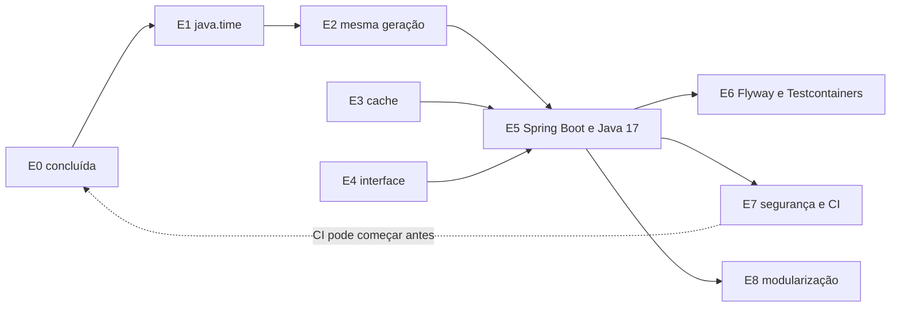

# Plano de atualização tecnológica do PetClinic

> **Rascunho** para a issue #27. Descreve o que já foi atualizado, o que falta e em que ordem fazer, com riscos e critérios de aceite. As versões alvo são sugestões e devem ser confirmadas no Maven Central no dia da execução.

Base de comparação: `v0-legado` (`df1596b`, agosto de 2014). Estado atual: `main`.

## 1. Objetivo e escopo

Levar o PetClinic de uma pilha de 2014 (Spring 4.0, Hibernate 4.3, JSP, Ehcache 2, Bootstrap 2) para uma pilha suportada, **sem parar de funcionar em nenhum momento**. O plano cobre plataforma, persistência, cache, interface, banco, segurança, operação e arquitetura. Ele decide a ordem das mudanças, e não só o destino.

O que já foi executado está na seção 8. O restante é plano de evolução, e a migração completa para Spring Boot não foi executada nesta entrega (ver a decisão registrada na issue #41).

## 2. Inventário e alvo

Versões lidas do `pom.xml` da `main`.

| Componente | Atual | Situação | Alvo sugerido | Etapa |
|---|---|---|---|---|
| Java | 1.8 (era 1.6) | Atualizado no PR #45 | 17 ou superior | E5 |
| Spring Framework | 4.0.6 | Fim de suporte | 4.3.x (última 4.x) e depois Boot | E2, E5 |
| Spring Data JPA | 1.6.2 | Fim de suporte | 1.11.x e depois a versão do Boot | E2, E5 |
| Hibernate ORM | 4.3.6 | Fim de suporte | 4.3.11 e depois a versão do Boot | E2, E5 |
| Hibernate Validator | 4.3.1 | Fim de suporte | Versão do Boot | E5 |
| Pacotes `javax.*` | em uso (JPA, validação, servlet) | Legado | `jakarta.*` | E5 |
| Servidor | Tomcat 7 (plugin 2.0), servlet 7.0.30 | Fim de suporte | Tomcat embarcado do Boot | E5 |
| Empacotamento | WAR | Dependente de contêiner | JAR executável | E5 |
| Camada de visão | JSP 2.2 e JSTL 1.2, duas tags próprias | Pouco usada em novos projetos | Thymeleaf | E5 |
| Configuração | 5 XMLs e `web.xml` (447 linhas) | Verbosa | `application.properties` e classes `@Configuration` | E5 |
| Cache | Ehcache 2.6.9 | Fim de suporte | Caffeine pela abstração do Spring | E3 |
| Datas | Joda-Time 2.4, Jadira 3.2.0, `joda-time-hibernate`, `joda-time-jsptags` | Substituídos por `java.time` | `java.time` com `AttributeConverter` | E1 |
| Interface | Bootstrap 2.3.0, jQuery 2.0.3, jQuery UI 1.10.3 (WebJars) | Fim de suporte | Bootstrap 5 e jQuery 3 | E4 |
| Tabelas | Dandelion DataTables 0.10.0 | Descontinuado | Tabela HTML simples ou DataTables direto | E4 |
| Atom e XML | Rome 1.0, JAXB 2.2.7 | Antigos | Rome atual e `jakarta.xml.bind`, ou Jackson XML | E5 |
| Monitoramento | Aspecto próprio com AspectJ 1.8.1 e JMX | Artesanal | Actuator e Micrometer | E5 |
| Log | Logback 1.1.2, SLF4J 1.7.7 | Antigos | Versões do Boot | E2, E5 |
| Banco | HSQLDB 2.3.2 em memória, MySQL (driver 5.1.49) | Esquema em `initDB.sql` | Flyway, MySQL 8 e Postgres | E6 |
| Testes | JUnit 4.11, Hamcrest 1.3, Mockito 1.10.19 (PR #55) | JUnit 4 | JUnit 5 e Testcontainers | E5, E6 |
| Plugins Maven | compiler 3.0, surefire 2.13, war 2.3, assembly 2.4, eclipse 2.9 | Muito antigos | Versões atuais, `maven-eclipse-plugin` removido | E2 |
| CI | Não há workflow | Sem automação | GitHub Actions com JDK 8 e 17 | E7 |

Referência de destino: o `spring-petclinic` upstream atual usa Java 17, Spring Boot 4.1.0, Spring Framework 7, Hibernate ORM 7.4, Thymeleaf 3.1 e Bootstrap 5.3 pelos WebJars.

## 3. Princípios

1. **Rede de proteção primeiro** (Feathers). A `main` tem 48 testes, incluindo 13 de controllers e 17 de consultas. Nenhuma etapa começa com a suíte vermelha.
2. **Uma etapa por vez**, em PRs pequenos, com o sistema rodando ao final de cada uma.
3. **Medir antes e depois** (Lizard, jscpd, número de testes, tempo de execução), como foi feito em `docs/metricas.md`.
4. **Reversível:** cada etapa pode ser desfeita revertendo seus PRs, sem depender das seguintes.
5. **Mudanças mecânicas separadas das mudanças de comportamento**, para a revisão ser possível.

## 4. Etapas

### E0. Concluída (nesta entrega)

| Mudança | PR |
|---|---|
| Java 1.6 para 1.8 e `ecj` para o Tomcat compilar JSP | #45 |
| Spring Data JPA como única implementação de repositório (removidas JDBC e JPA, 345 linhas efetivas) | #43 |
| Banco selecionado por `petclinic.db`, credenciais por ambiente, `createDB.sql` separado do esquema | #44 |
| Driver MySQL 5.1.49 como dependência runtime | #48 |
| Testes de controllers (13) e de consultas (17); Mockito (#55) | #47, #49, #51 |

### E1. Datas: Joda-Time e Jadira para `java.time` (issue #26)

- **Mudança:** `Pet.birthDate` e `Visit.date` passam a `java.time.LocalDate`, com `AttributeConverter` (JPA 2.1) no lugar do Jadira. Remove `joda-time`, `joda-time-hibernate`, `joda-time-jsptags` e `jadira`.
- **Por que primeiro:** é pequena, não depende de nada e é pré-requisito do Hibernate 5 e do Spring Boot, que não têm suporte ao Jadira nem ao Joda como base.
- **Risco:** médio. Toca `Pet`, `Visit`, os JSP com `fmt` e o `@DateTimeFormat`. **Aceite:** nenhum `org.joda` ou `org.jadira` restante, 48 testes verdes, cadastro de pet e de visita funcionando.
- **Esforço:** 3 a 5 h.

### E2. Atualizações dentro da mesma geração

- **Mudança:** Spring Framework 4.0.6 para 4.3.x, Spring Data JPA 1.6 para 1.11.x, Hibernate 4.3.6 para 4.3.11, Logback e SLF4J (patch), plugins Maven (compiler, surefire, war), remoção do `maven-eclipse-plugin`.
- **Por que:** ganha correções de segurança e de compatibilidade com Java 8 sem trocar de API, o que prepara o terreno para a migração maior.
- **Risco:** baixo a médio. **Aceite:** suíte verde, telas conferidas no Tomcat, sem aviso novo de depreciação relevante.
- **Esforço:** 2 a 4 h.

### E3. Cache: Ehcache 2 para Caffeine

- **Mudança:** manter `@Cacheable("vets")` e a abstração de cache do Spring, trocar o provedor para Caffeine e apagar o `ehcache.xml` e o XSD.
- **Risco:** baixo. **Aceite:** teste que prova que a segunda chamada de `findVets` não vai ao repositório.
- **Esforço:** 2 h.

### E4. Interface: Bootstrap 2 e jQuery 2 para versões atuais; fim do Dandelion

- **Mudança:** Bootstrap 5 e jQuery 3 pelos WebJars, e tabela de tutores e de veterinários sem Dandelion (HTML simples ou DataTables direto).
- **Por que separada:** é independente do backend e pode ser feita em paralelo.
- **Risco:** médio (CSS do Bootstrap 2 para 5 muda classes). **Aceite:** telas equivalentes, sem erro no console, textos nos `messages*.properties`.
- **Esforço:** 6 a 8 h.

### E5. Plataforma: Spring Boot e Java 17

Maior etapa. Executar em uma branch única, integrando só no final, nesta ordem:

1. **Esqueleto Boot:** `spring-boot-starter-parent`, `@SpringBootApplication`, `application.properties` com HSQLDB e os scripts de inicialização atuais.
2. **XML para configuração Java e propriedades:** os cinco XMLs e o `web.xml`.
3. **`javax` para `jakarta`:** é uma mudança de "dia único" (todos os imports e as dependências juntas). Fazer depois de E1 e E2 para reduzir o número de variáveis.
4. **JSP para Thymeleaf:** 12 páginas e 2 tags (`inputField`, `selectField` viram fragmentos). Os testes de MockMvc preservam os nomes de view.
5. **WAR para JAR executável**, remoção do plugin do Tomcat 7.
6. **Atom e XML de veterinários:** Rome e JAXB atuais, ou Jackson XML.
7. **Monitoramento:** o aspecto `CallMonitoringAspect` e o JMX dão lugar ao Actuator e ao Micrometer.
8. **Testes para JUnit 5**, quando conveniente.

- **Risco:** alto. **Mitigação:** testes de caracterização existentes, branch única, go/no-go por tempo (ver a decisão na #41) e nenhuma mudança de regra de negócio junto.
- **Aceite:** `mvn clean verify` verde em JDK 17, as mesmas rotas e views, a mesma saída de `/vets` em HTML, XML e Atom.
- **Esforço:** 16 a 24 h para duas pessoas.

### E6. Banco: migrações versionadas

- **Mudança:** Flyway no lugar de `initDB.sql` e `populateDB.sql` executados em todo startup, MySQL 8 e PostgreSQL por perfil, Testcontainers nos testes de integração.
- **Por que depois do Boot:** o Flyway tem integração direta e pronta com o Boot.
- **Risco:** médio (três dialetos). **Aceite:** uma migração por mudança de esquema, testes passando em HSQLDB e em MySQL via Testcontainers.
- **Esforço:** 6 a 8 h.

### E7. Segurança, operação e automação

- **Segurança:** hoje não há autenticação nem controle de acesso. Adicionar Spring Security (por exemplo, funcionários autenticados e visitantes só leitura), com CSRF e cabeçalhos seguros.
- **Operação:** Actuator restrito (`health`, `info`, `metrics`), logs estruturados e configuração por variáveis de ambiente (já iniciada na E0).
- **Automação:** GitHub Actions rodando `mvn clean test` em JDK 8 e 17, com o relatório de cobertura como artefato.
- **Esforço:** 6 a 10 h.

### E8. Arquitetura: modularização e quebra do monólito

- **Mudança:** serviços por contexto (`OwnerService`, `PetService`, `VisitService`, `VetService`) e formulários separados das entidades, conforme `docs/plano-modularizacao.md`.
- **Quebra em serviços:** só se houver necessidade de negócio. O melhor candidato é o contexto de veterinários, que é somente leitura, tem cache próprio e um único repositório. Tutores, animais e visitas formam um agregado e devem ficar juntos.
- **Risco:** médio a alto. **Aceite:** sem ciclos entre pacotes e fluxos já caracterizados preservados.
- **Esforço:** 12 a 20 h.

## 5. Ordem e dependências

A E3 e a E4 são independentes e podem andar em paralelo com a E1 e a E2. A E7 de **automação** (CI) não precisa esperar o Boot e traz valor imediato.

## 6. Riscos e mitigação

| Risco | Prob. | Impacto | Mitigação |
|---|---|---|---|
| `javax` para `jakarta` quebra muitos arquivos de uma vez | Alta | Alto | Fazer depois de E1 e E2, em branch única, com a suíte como árbitro |
| JSP para Thymeleaf muda o HTML gerado | Média | Médio | Testes de MockMvc por nome de view e conferência manual das telas |
| Hibernate 4 para 5 ou 6 muda consultas e mapeamento | Média | Alto | `PersistenceQueriesTests` cobre as consultas com os dados de exemplo |
| Migração sem tempo ou sem pessoas | Alta | Médio | Etapas pequenas e independentes (E1 a E4); go/no-go por tempo na E5 |
| Banco: diferenças entre HSQLDB, MySQL e PostgreSQL | Média | Médio | Testcontainers e Flyway por dialeto; MySQL 5.7 já comprovado no PR #44 |
| Dependência GPL do Connector/J 5.1 | Baixa | Médio | Avaliar o MariaDB Connector ou o MySQL Connector/J atual com a licença do projeto |
| Perda de comportamento na refatoração | Média | Alto | Mudanças mecânicas separadas das de comportamento; 48 testes de regressão |

## 7. Priorização e estimativas

Estimativas do grupo, **não** medições. Prioridade pelo valor e pelo risco.

| Prioridade | Etapas | Esforço total |
|---|---|---|
| Deve (próximo ciclo) | E1, E2, E3, E7 (CI) | 9 a 15 h |
| Deveria | E4, E5, E6 | 28 a 40 h |
| Poderia | E7 (segurança), E8 | 16 a 26 h |

## 8. Relação com o que foi entregue

| Item do plano | Estado |
|---|---|
| E0 (Java 8, Spring Data único, configuração por ambiente, driver, testes) | Entregue e validada em JDK 8 (48 testes) |
| E1 (`java.time`) | Em andamento (#26) |
| E2 a E8 | Planejadas; a E5 não foi executada nesta entrega (decisão na #41) |

Resultado medido da E0, em `docs/metricas.md`: 504 para 40 linhas nas implementações de persistência, Javadoc de 17,7% para 29,5% e 33 para 48 testes.

## 9. Critérios de pronto, por etapa

- `mvn clean test` verde em JDK 8 (e em JDK 17 a partir da E5).
- As telas conferidas no Tomcat (busca, detalhes do tutor, cadastro de pet e de visita, veterinários em HTML e XML).
- Métricas atualizadas em `docs/metricas.md` quando a etapa muda código de produção.
- Trecho Antes/Depois em `docs/modulos/` com a explicação técnica.

## 10. Pendências do rascunho

- [ ] Confirmar no Maven Central as versões alvo da E2 e da E5.
- [ ] Revisar as estimativas com o grupo.
- [ ] Decidir quem assume a redação final (issue #27).
- [ ] Atualizar a seção 8 quando a #26 for mergeada.
